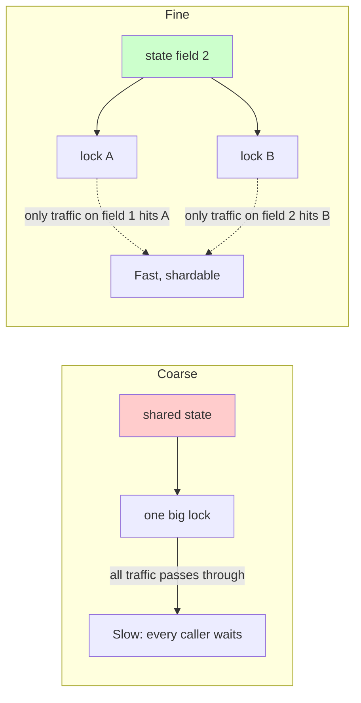

# Coarse vs Fine-grained Locking

## Definitions

- **Coarse-grained**: one lock protects the entire shared object. Easy to reason about, hard to scale because every contended call blocks everyone else.
- **Fine-grained**: many smaller locks protect disjoint fields / stages of the operation. Harder to reason about across stages, easier to scale to high contention.

### The visual difference



## Why it matters

The rule of thumb in reviews: coarse-grained is fine for startup and small services, but once throughput matters, partition your shared data so each hot path only needs its own lock. The question "why did a reviewer suggest we switch from one mutex to lock striping?" traces back to contention point X — naming that point is the Staff answer.

## When you'll see it

- A popular feed's page cache: `textCache` vs `avatarCache` keyed separately.
- Room transaction semantics; a single `@Transaction` can itself be a coarse-grained section.
- Sharded in-memory indexes where different shards lock separately.

## Trade-off table

| Aspect            | Coarse                                     | Fine                                            |
|-------------------|--------------------------------------------|-------------------------------------------------|
| Scalability       | Low                                        | High                                            |
| Correctness       | Easier to get right                       | Easier to get stuck in inconsistent intermediate state |
| Deadlock risk     | Lower (fewer lock orders)                 | Higher (must track per-stage lock order)       |
| Throughput        | Acceptable for low/medium load            | Required for high/burst loads                  |

## Code example

### Coarse-grained (one lock for everything)

```kotlin
class CacheManager {
    private val lock = Mutex()
    private val textCache = ConcurrentHashMap<String, String>()
    private val avatarCache = ConcurrentHashMap<String, ByteArray>()

    suspend fun getText(key: String): String? {
        lock.withLock { return textCache[key] }  // ❌ All traffic serialised
    }

    suspend fun getAvatar(key: String): ByteArray? {
        lock.withLock { return avatarCache[key] } // ❌ Avatar reads also wait
    }
}
```

### Fine-grained (separate locks per field)

```kotlin
class CacheManager {
    private val textLock = Mutex()
    private val avatarLock = Mutex()
    private val textCache = ConcurrentHashMap<String, String>()
    private val avatarCache = ConcurrentHashMap<String, ByteArray>()

    suspend fun getText(key: String): String? {
        textLock.withLock { return textCache[key] }  // ✅ Only text traffic serialised
    }

    suspend fun getAvatar(key: String): ByteArray? {
        avatarLock.withLock { return avatarCache[key] } // ✅ Only avatar traffic serialised
    }
}
```

## System Design guidance

Partition by the *owner field*, not by the caller. Callers touching field X should always take lock X; never take the global lock in the middle of field-X work. That discipline eliminates most deadlocks and maximizes parallelism. Where fields do not naturally partition, consider a striped lock array (e.g., `ReadWriteLock` per 64 bytes).

## Key takeaway

Coarse-grained locking is simpler but doesn't scale; fine-grained locking is more complex but scales better. Choose based on your throughput requirements.