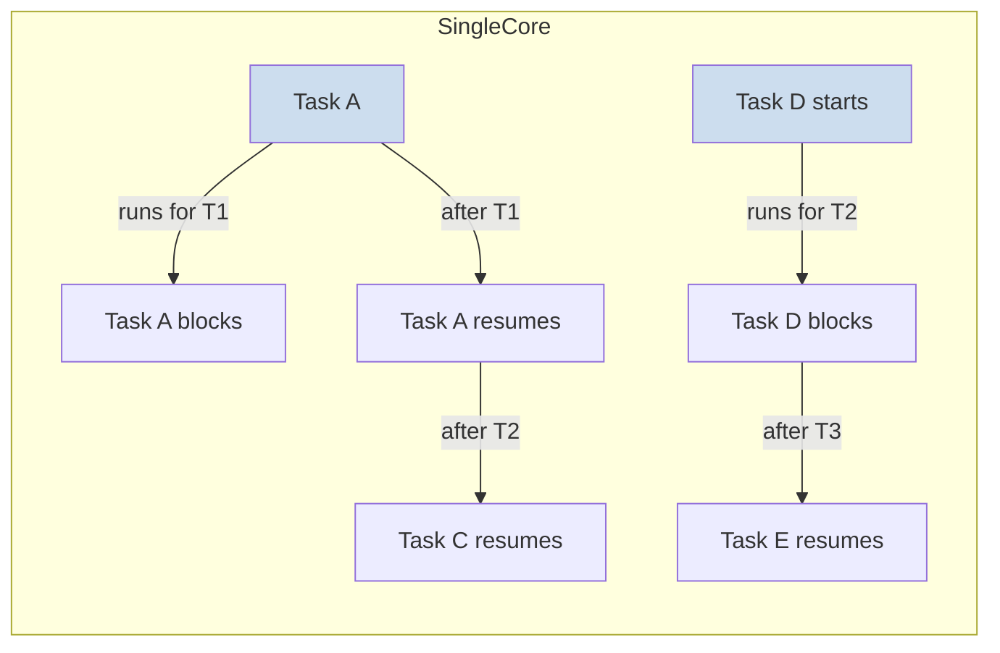

# Concurrency

## What is concurrency?

**Concurrency** is the property of a program where multiple tasks make progress within the same time window, even if no single task executes at exactly the same instant. Concurrency is about *interleaving* work — tasks share CPU time, then yield, then resume, over and over.

### The mental model: one CPU, many tasks

Imagine a single CPU with three tasks queued. The CPU runs Task A for a while, then the scheduler pauses it and runs Task B, then Task C, then back to Task A. From the outside, all three are making progress. From the inside, only one runs at any moment.

### The two kinds of progress

| Kind          | What it means                                   | Example                                            |
|---------------|-------------------------------------------------|----------------------------------------------------|
| Logical       | Task A and Task B are both "in flight"         | A coroutine fetches data; B updates UI            |
| Physical      | Task A and Task B truly run at the same instant | Two threads on two CPU cores                      |

Concurrency is the logical kind. Parallelism is the physical kind. A program can be concurrent without being parallel.

### Why concurrency exists

- **Hardware**: multi-core machines are now the norm, so the OS naturally schedules multiple threads at once.
- **I/O latency**: disk, network, and database round-trips take milliseconds; a single thread blocked on I/O wastes the CPU. Concurrency lets the CPU keep working while one thread waits.
- **Responsiveness**: the UI thread must stay responsive while background work runs. Without concurrency the app would freeze.

### When you will see concurrency

- Designing an offline-first app whose local database must absorb writes from background network fetches while the UI thread reads.
- Deciding whether two independent HTTP requests fired on different dispatchers are concurrent or parallel.
- Choosing `coroutineScope` vs `supervisorScope` when writing the production module that pulls remote data.

### System Design summary

Concurrency is the umbrella term. The concrete concurrency model in a system is one of:

| Aspect         | Choice                          | Example                                      |
|----------------|---------------------------------|----------------------------------------------|
| Scheduling     | Single-threaded cooperative     | Main-thread UI updates                       |
| Scheduling     | Multi-threaded preemptive       | `Executors.newFixedThreadPool(n)`            |
| Scheduling     | Structured coroutine            | `CoroutineScope(Dispatchers.IO).launch{}`    |
| Memory model   | Shared mutable                  | Static fields touched by many threads        |
| Memory model   | Isolated / confined             | Thread-local state                           |

### Key takeaway

Two threads never need to execute simultaneously to be concurrent. That distinction — between concurrency and parallelism — is what separates junior answers from Staff engineer answers. If you can name both terms and explain the difference, you have already cleared the first filter question of any concurrency interview.