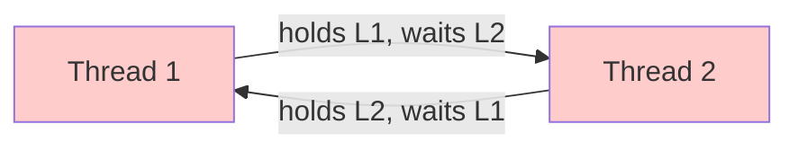

# Deadlock

## Definition

Two threads each hold a lock and are blocked waiting for a second lock held by the other — neither can ever make progress. Formally: a cycle in the lock-acquisition graph of two threads where each edge is "waiting on."



### Three classic cycles

| Cycle              | Scenario                                            |
|--------------------|-----------------------------------------------------|
| Pairwise           | Thread A holds X, waits Y; Thread B holds Y, waits X |
| Circular (3+)      | Thread A holds X, waits Z; Thread B holds Z, waits Y; Thread C holds Y, waits X |
| Timeout retry      | Mutual timeout retry combined with a slow holder creates the same cycle after retries expire |

## Why it matters

Deadlocks consume CPU and stall the whole system; unlike starvation they surface only under load. Staff engineering answers must name the **three conditions**: mutual exclusion (needed for a lock), *no* preemption (locks cannot be stolen mid-section), and circular wait. The strongest fix kills *one* condition; the safest fix eliminates *all three*.

## Code example: deadlock scenario

```kotlin
class Account {
    var balance = 0
    val lock = java.util.concurrent.locks.ReentrantLock()

    fun transfer(from: Account, to: Account, amount: Int) {
        from.lock.lock()
        to.lock.lock()
        try {
            from.balance -= amount
            to.balance += amount
        } finally {
            to.lock.unlock()
            from.lock.unlock()
        }
    }
}

// Two concurrent transfers can deadlock:
// Thread A: transfer(from=A, to=B) → locks A then B
// Thread B: transfer(from=B, to=A) → locks B then A
```

### Typical deadlock execution

```
Thread A: lock(A) ✅ → lock(B) ⏸️ (waiting for Thread B to unlock B)
Thread B: lock(B) ✅ → lock(A) ⏸️ (waiting for Thread A to unlock A)
Neither ever proceeds.
```

## Remedies (pick one primary)

| Strategy                     | Tracks how often it appears            |
|------------------------------|---------------------------------------|
| **Global lock ordering**     | eliminates most pairwise cycles       |
| **Lock at the outermost scope** | frees deadlock reasoning from nesting |
| **Non-blocking paths only**  | breaks mutual exclusion as soon as possible |
| **Timeout + retry**          | leaves eventual deadlock risk         |
| **Deadlock detection**       | runtime cost proportional to \#locks  |

Use **global ordering** and keep sections tiny; avoid timed waits on lock-held paths.

## Global ordering example

```kotlin
// Always lock in the same order: lower address first
class Account {
    var balance = 0
    val lock = java.util.concurrent.locks.ReentrantLock()
}

fun safeTransfer(from: Account, to: Account, amount: Int) {
    val first = if (System.identityHashCode(from) < System.identityHashCode(to)) from else to
    val second = if (first == from) to else from

    first.lock.lock()
    second.lock.lock()
    try {
        from.balance -= amount
        to.balance += amount
    } finally {
        second.lock.unlock()
        first.lock.unlock()
    }
}
```

## Key takeaway

Deadlocks happen when two threads wait for each other's locks. Prevent them by using consistent lock ordering and never nesting locks unnecessarily.