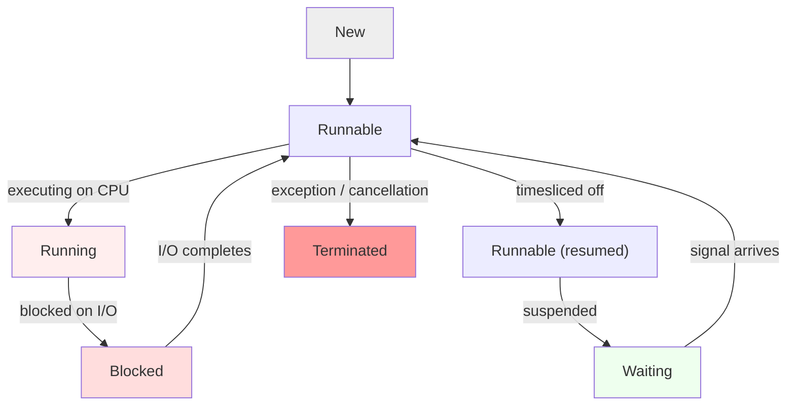

# Thread Lifecycle

Every OS thread passes through a finite sequence of states before terminating. Understanding these states is the foundation for diagnosing any concurrency bug.

## The six states



### New
The thread object exists in memory but has not started. Calling `start()` transitions it to `Runnable`.

```kotlin
val t = Thread { println("running") }  // state: New
t.start()                              // state: Runnable
```

### Runnable
The thread is eligible to execute but may be preempted or queued. The OS scheduler decides when it actually gets a CPU. Multiple threads in `Runnable` state compete for the same CPU slots.

### Running
The thread is currently executing on a CPU. It continues until it yields, blocks, or is preempted.

### Blocked
The thread is stopped while waiting for a lock, I/O, or signal. It cannot make progress until the blocking condition resolves.

```kotlin
val lock = Object()
val t1 = Thread {
    synchronized(lock) {
        Thread.sleep(1000) // t1 is Blocked on the lock
    }
}
val t2 = Thread {
    synchronized(lock) {  // t2 is Blocked waiting for lock
        println("got lock")
    }
}
t1.start()
t2.start()
```

### Waiting
The thread is parked waiting on a condition or timeout. Unlike `Blocked`, it is not waiting for a lock — it is waiting for a signal.

```kotlin
val monitor = Object()
val t = Thread {
    synchronized(monitor) {
        monitor.wait() // state: Waiting
    }
}
```

### Terminated
The thread's `run()` method finished (normally or via exception). It cannot be restarted.

## Why this matters

You will almost never see `New` directly; the interesting boundaries are `Runnable → Running`, `Running → Blocked`, `Blocked → Runnable` (I/O returned), `Runnable → Waiting` (parked on condition), and `Running → Terminated`. Recognizing these transitions tells you where concurrency hazards live.

### When you will see it

- **"What happens to the UI thread when an `onStop()` callback blocks?"** — the thread stays in `Waiting`; other tasks still get slices, but the app stutters.
- **"How do you detect whether a long-lived background task is stuck in `Blocked`?"** — check whether its wait predicate fires.
- **"Why is my app not responding?"** — the main thread is in `Blocked` waiting on a lock held by a background thread.

## System Design summary

Never pin yourself to a single state label. The useful abstraction in high-level code is *active vs passive*: active threads consume CPU and can stall the system; passive threads sleep. Concurrency design minimizes active-CPU holding by pushing work onto passive threads and parking them when idle.

## Key takeaway

The thread lifecycle is the state machine behind every concurrency primitive. If you understand these six states, you can trace any deadlock, livelock, or starvation to its root cause.